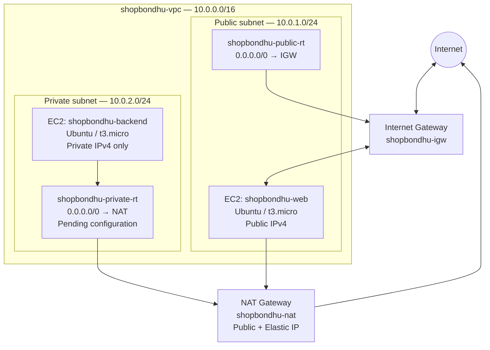

# ShopBondhu — AWS Cloud Assignment

This repository records my work on the **“Launch Day at ShopBondhu”** AWS assignment. The goal is to build a small VPC network with separate public and private subnets, deploy a public web server, and allow a private backend server to reach the internet through a NAT Gateway.

I have kept the notes close to what I configured in the AWS Console. Where a setting still needs a final check or a task is blocked, I have called that out instead of marking it complete.

> **Screenshot upload note:** The full-screen PNG evidence referenced in this README has been collected in a separate archive supplied with this update. The GitHub text-file connection used for this push cannot attach local binary image files directly, so the `screenshots/*.png` files are **not yet present in the remote repository**. Download `shopbondhu-screenshots-evidence.zip`, extract it into the repository root, and follow [UPLOAD-SCREENSHOTS.md](UPLOAD-SCREENSHOTS.md) to add the images. Until then, the embedded image paths below will not render on GitHub.

> **Repository-name check:** This repository is currently named `hopbondhu-aws-assignment`. The assignment submission guideline specifies `shopbondhu-aws-assignment`. I kept the repository URL you supplied; rename it in GitHub before final submission if the required name is enforced exactly.

> **Current progress:** Tasks 1–3 are verified. A Zonal public NAT Gateway was configured with an Elastic IP, but its final `Available` state still needs to be confirmed. The public route table is verified. The private route table is not finished yet. Both EC2 instances have been launched. Task 7 is blocked by an SSH timeout, so Nginx installation has not yet been confirmed.

## 1. Project Title & Short Description

**Project:** Launch Day at ShopBondhu  
**Cloud provider:** Amazon Web Services (AWS)  
**Region:** Asia Pacific (Mumbai), `ap-south-1`  
**Availability Zone used:** `ap-south-1a`

The network uses one custom VPC (`10.0.0.0/16`) with a public subnet for the web instance and a private subnet for the backend instance. The web instance is intended to serve the ShopBondhu static website. The backend instance should have no public IPv4 address and should use the NAT Gateway for outbound internet access.

## 2. Architecture Diagram

The diagram below shows the intended final architecture. The private subnet's NAT route and association still need to be completed and verified in AWS; the diagram is the target design, not proof that those final routes are active.



## 3. Resources Created

### VPC and subnets

| Resource | Name | CIDR / ID | Recorded state |
|---|---|---|---|
| VPC | `shopbondhu-vpc` | `10.0.0.0/16` · `vpc-08ebe25d4e723da95` | Available |
| Public subnet | `shopbondhu-public-subnet` | `10.0.1.0/24` · `subnet-0885e6784f98b1797` | Available; auto-assign public IPv4 enabled |
| Private subnet | `shopbondhu-private-subnet` | `10.0.2.0/24` · `subnet-0df6f70bd9ac09ef4` | Available; auto-assign public IPv4 disabled |

Both subnets were created in `ap-south-1a`. The screenshots also show the default VPC's `172.31.0.0/16` subnets; those are not part of this ShopBondhu VPC.

### Internet and NAT gateways

| Resource | Name / identifier | Notes |
|---|---|---|
| Internet Gateway | `shopbondhu-igw` · `igw-0a907c5992d488d8f` | Attached to `shopbondhu-vpc` |
| NAT Gateway | `shopbondhu-nat` | Recreated using **Zonal** availability mode, **Public** connectivity, in `shopbondhu-public-subnet` |
| Elastic IP | `13.127.215.248` · allocation `eipalloc-0a64b83ea93ead5e0` | Allocation confirmation was shown during NAT creation; final NAT association and `Available` state still need a fresh check |

The earlier NAT attempt used Regional mode and was replaced during setup. Do not treat that earlier Regional NAT Gateway as the final assignment resource.

### Route tables

| Route table | ID | Verified configuration |
|---|---|---|
| `shopbondhu-public-rt` | `rtb-05e2ac531a8e63834` | `10.0.0.0/16 → local`; `0.0.0.0/0 → igw-0a907c5992d488d8f` (Active). Public subnet association is visible in the console. |
| `shopbondhu-private-rt` | `rtb-013bb871ffcdabc75` | The captured Routes tab showed only `10.0.0.0/16 → local`. The captured Subnet associations tab showed zero explicit associations, with the private subnet still using the main route table. **The NAT default route and private subnet association remain to be configured.** |

### Security groups

| Security group | ID | Inbound rules visible in the evidence |
|---|---|---|
| `shopbondhu-web-sg` | `sg-09297bddbcad5b506` | HTTP TCP/80 from `0.0.0.0/0`; SSH TCP/22 restricted to a `/32` My IP address. The public IP changed during troubleshooting, so the SSH source must be refreshed to the current public IP before connecting. |
| `shopbondhu-backend-sg` | `sg-05d2b9090e9eae775` | SSH TCP/22 from the web security group `sg-09297bddbcad5b506` only. |

The default network ACL associated with the VPC was inspected. The captured inbound rules show rule 100 allowing all traffic, followed by the default `*` deny rule. The outbound rules were not included in the final evidence set.

### EC2 instances

| Property | Web instance | Backend instance |
|---|---|---|
| Name | `shopbondhu-web` | `shopbondhu-backend` |
| Instance ID | `i-09d65b3b77d3a8f43` | `i-030f69dbd8c16a31e` |
| AMI family | Ubuntu Server | Ubuntu Server |
| Instance type | `t3.micro` | `t3.micro` |
| Subnet | `shopbondhu-public-subnet` | `shopbondhu-private-subnet` |
| Private IPv4 | `10.0.1.219` | `10.0.2.232` |
| Public IPv4 | `13.206.195.203` (observed in the instance details) | None |
| Security group | `shopbondhu-web-sg` | `shopbondhu-backend-sg` |
| State in captured details | Running | Running |

The Web instance's status page showed its system, instance, and EBS checks as passed. The backend details screenshot showed it running with no public IPv4 address. The EC2 instances list screenshot was captured while the backend status check was still initializing; the later backend details screenshot confirms the instance state as Running. The instance-level Security tab was not captured in this evidence set, so the backend Security Group attachment still needs an explicit screenshot.

The SSH key pair is named `shopbondhu-key` (RSA). The private `.pem` file is kept locally and is deliberately not included in this repository.

## 4. Step-by-Step Setup

The resources were created manually in the AWS Management Console, in this order:

1. Created `shopbondhu-vpc` with IPv4 CIDR `10.0.0.0/16`.
2. Created `shopbondhu-public-subnet` (`10.0.1.0/24`) and enabled auto-assign public IPv4.
3. Created `shopbondhu-private-subnet` (`10.0.2.0/24`) and left auto-assign public IPv4 disabled.
4. Created `shopbondhu-igw` and attached it to `shopbondhu-vpc`.
5. Created a Zonal, Public NAT Gateway configuration in the public subnet and allocated an Elastic IP. Its final status/association still needs confirmation.
6. Created `shopbondhu-public-rt`, added the active default route to the Internet Gateway, and associated the public subnet.
7. Created `shopbondhu-private-rt`. The captured state shows that its NAT default route and explicit private subnet association are still outstanding.
8. Created the web and backend security groups with the inbound rules listed above.
9. Created the RSA key pair `shopbondhu-key` and downloaded its private key locally.
10. Launched `shopbondhu-web` in the public subnet with a public IPv4 address.
11. Launched `shopbondhu-backend` in the private subnet with public IP assignment disabled.

### Evidence captured so far

The screenshots below are full-window AWS Console captures supplied during the assignment. Some important evidence is still missing; the list is explicit so it is clear what remains to be captured.

**VPC and subnet evidence**


**Route table evidence**


The private route table screenshots are evidence of the captured, unfinished state; they are not evidence of a completed NAT route.

**EC2 and security group evidence**


This capture shows the backend Security Group and its SSH source rule. It is not the EC2 instance's Security tab, so take a separate instance-level screenshot to prove that this group is attached to `shopbondhu-backend`.


The Web Security Group screenshot shows a My IP `/32` value from the time it was captured. The public IP changed afterwards, so this screenshot should not be treated as proof that SSH currently allows the user's latest IP.


### Evidence still to capture

- Full-screen Internet Gateway attachment details (`shopbondhu-igw`).
- NAT Gateway details showing the final Zonal gateway in `Available` state and its associated Elastic IP.
- Full-screen public route table **Routes** tab (the public subnet association is captured separately).
- Updated private route table showing `0.0.0.0/0 → shopbondhu-nat` as Active.
- Updated private route table **Subnet associations** tab showing `shopbondhu-private-subnet` explicitly associated.
- A current full-screen Web Security Group rule screenshot with the current My IP `/32` value.
- Full-screen Web instance details and Security tab screenshots, if a consolidated evidence set is required.
- Nginx installation, service status, default welcome page, and private backend connectivity screenshots (Tasks 7–9).

## 5. Nginx & Frontend Deployment

**Status: Not completed.**

The intended web server is `shopbondhu-web` (`13.206.195.203`). SSH attempts from Windows PowerShell to TCP/22 timed out, so the Ubuntu package update and Nginx installation have not been confirmed. The default Nginx page has not been verified in a browser.

Once SSH access is restored, the planned commands are:

```bash
sudo apt update
sudo apt install nginx -y
sudo systemctl start nginx
sudo systemctl enable nginx
sudo systemctl status nginx --no-pager
curl -I http://localhost
```

After Nginx is installed, the default page should be checked at `http://<web-instance-public-ip>`. The ShopBondhu frontend deployment is a later step and should only be documented as complete after the actual files are uploaded and verified.

## 6. NAT Gateway Test

**Status: Not tested yet.**

The intended test is to connect from the web EC2 to the backend EC2 over its private address, then run these commands on the backend:

```bash
sudo apt update
curl -I https://google.com
```

A successful package update and HTTP response would demonstrate outbound connectivity from the private subnet. The private route table currently lacks the captured NAT default route and private-subnet association, so this test should wait until Task 5 is corrected and the NAT Gateway is confirmed Available.

## 7. Troubleshooting Answers

### Problem A: The website does not open in the browser, but SSH to the web server works.

Possible causes and checks:

1. **HTTP is not allowed by the Web Security Group.** Check that inbound TCP/80 is allowed from `0.0.0.0/0`.
2. **Nginx is not running.** Check with `sudo systemctl status nginx`; start or restart it if required.
3. **The web files are missing or in the wrong directory.** Check `/var/www/html` and confirm that `index.html` and referenced assets are present.
4. **The public network route is incorrect.** Confirm that the public subnet uses a route table with `0.0.0.0/0` pointing to the attached Internet Gateway.
5. **The browser is using the wrong address or protocol.** Use the instance's current public IPv4 address and `http://` for this task.

### Problem B: `sudo apt update` on the backend hangs or times out.

Possible causes and checks:

1. **The NAT Gateway is not Available or has no usable Elastic IP association.** Check the NAT Gateway details in the VPC console.
2. **The private route table has no NAT default route.** Add `0.0.0.0/0` pointing to the correct NAT Gateway.
3. **The private subnet is not associated with the private route table.** Check explicit subnet associations.
4. **The public subnet route used by the NAT Gateway is incorrect.** Confirm `0.0.0.0/0` points to the Internet Gateway and the gateway is attached to the VPC.
5. **Outbound traffic or DNS is blocked.** Check Security Group outbound rules, Network ACL outbound/return traffic rules, and DNS resolution.

## 8. Cleanup

Cleanup has **not** been performed because the assignment is still in progress. NAT Gateways and public IPv4 addresses can incur charges while allocated or in use. After capturing final evidence and submitting the assignment, remove resources that are no longer needed in a dependency-aware order, then verify that the NAT Gateway is deleted and the Elastic IP is released.

Do not release the Elastic IP while it is still associated with a NAT Gateway. Do not delete resources before the assignment evidence has been captured.

## 9. What I Learned

This part of the assignment has helped me practise creating a VPC, dividing it into public and private subnets, attaching an Internet Gateway, and configuring route tables. I also created separate security groups for the web and backend servers and launched EC2 instances with different public-IP settings. The remaining work is to finish the private NAT route, resolve SSH access, configure Nginx, deploy the static site, and prove outbound connectivity from the private server.
