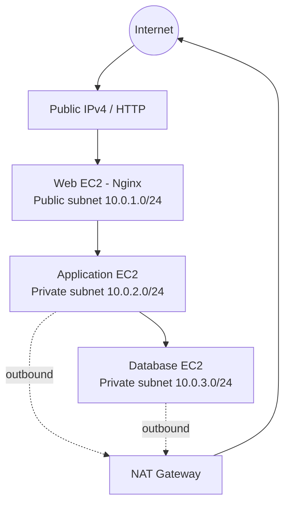

# Ostad Module 4 — Deploy a 3-Tier Application on a Custom AWS VPC

**AWS region shown in screenshots:** Asia Pacific (Singapore), `ap-southeast-1`.  
**Evidence date:** 8 November 2026.

> **Evidence-based status:** This README records what the supplied screenshots show. It does not claim that every assignment requirement has been independently verified. The Todo page demonstrates a rendered application interface and one displayed record, but the screenshots do not show a successful Add record operation, a database read-after-write test, or persistence after a restart.

## Assignment requirements

The brief requires:
- Web tier: EC2 + Nginx in a public subnet.
- Application tier: EC2 in a private subnet.
- Database tier: EC2 running MySQL or PostgreSQL in a private subnet.
- The Web server is the only public entry point.
- Application and database ports must not be open to the internet.
- Users can add and view records; records persist in the database.
- Submission includes source code, configuration files, README, architecture diagram, AWS screenshots, and a short note about problems and solutions.
- Prohibited: ALB/NLB, RDS, Elastic Beanstalk, ECS and EKS.
- Bonus: load balancing between two application servers, HTTPS on Nginx, and automated setup.

## Observed resources

The screenshots show a CloudFormation stack named `ostad-3tier-assignment`, a custom VPC, three subnets, three security groups, EC2 instances, a private route via NAT, and a browser page titled **Three-Tier Todo**.

### Network

| Resource | Observed value |
|---|---|
| VPC | `ostad-3tier-vpc` — `vpc-0d412fecabb7c96b3` |
| Public subnet | `ostad-public-subnet` — `10.0.1.0/24` |
| Application subnet | `ostad-app-private-subnet` — `10.0.2.0/24` |
| Database subnet | `ostad-db-private-subnet` — `10.0.3.0/24` |
| Public subnet auto-assign IPv4 | Yes |
| Private route table | `rtb-0b2eb1a247b5be677` |
| NAT Gateway | `nat-02c356eca2b7724df` |
| Private default route | `0.0.0.0/0 → nat-02c356eca2b7724df` — Active in captured screenshot |
| Private subnet associations | App and DB subnets explicitly associated |

The supplied screenshots do not show the Internet Gateway attachment details or the public route table's default route. Capture these separately before final submission.

### Security groups

| Tier | Security group | ID |
|---|---|---|
| Web | `ostad-3tier-web-sg` | `sg-06cc9202ecc85ef8d` |
| Application | `ostad-3tier-app-sg` | `sg-01490e2896c990376` |
| Database | `ostad-3tier-db-sg` | `sg-0dad58e2492aae49d` |

The screenshot proves that the three groups exist in the custom VPC. It does **not** show their individual ingress/egress rules; least-privilege rules still need separate verification.

### CloudFormation outputs

Stack: `ostad-3tier-assignment` — status `UPDATE_COMPLETE`.

| Output | Value |
|---|---|
| AppInstanceId | `i-064d3438e1712b3c0` |
| AppSecurityGroupId | `sg-01490e2896c990376` |
| DatabaseInstanceId | `i-02efb258bbd635faf` |
| DatabaseSecurityGroupId | `sg-0dad58e2492aae49d` |
| NatGatewayId | `nat-02c356eca2b7724df` |
| WebInstanceId | `i-0343b7a8c72c749c3` |
| WebPublicIp | `13.212.44.72` |
| WebSecurityGroupId | `sg-06cc9202ecc85ef8d` |
| WebURL | `http://13.212.44.72` |

The EC2 list screenshot shows multiple instances under the `ostad-3tier` filter. The visible App instance `i-064d3438e1712b3c0` and DB instance `i-02efb258bbd635faf` are Running with 3/3 checks passed. Some other rows are Terminated; the visible Web row is Terminated and its ID is not the same as the WebInstanceId in the CloudFormation outputs. These may represent different stack/resource generations. Verify the current state of `i-0343b7a8c72c749c3` and update stack outputs before submission.

## Architecture

This illustrates the intended design, not proof of the actual current security policy or runtime connections.

## Screenshots

### 1. VPC creation workflow

Shows successful creation workflow for VPC `vpc-0d412fecabb7c96b3`, DNS settings, subnets, Internet Gateway, route tables, routes, associations and an S3 VPC endpoint.

### 2. Three subnet list

Shows three available subnets:
- `ostad-app-private-subnet`: `10.0.2.0/24`
- `ostad-public-subnet`: `10.0.1.0/24`
- `ostad-db-private-subnet`: `10.0.3.0/24`

### 3. Public subnet settings

Shows `ostad-public-subnet`, CIDR `10.0.1.0/24`, Available state, and Auto-assign public IPv4 set to Yes.

### 4. Private route via NAT

Shows private route table `rtb-0b2eb1a247b5be677`, the application and database subnet associations, and Active `0.0.0.0/0` via NAT Gateway `nat-02c356eca2b7724df`. The local `10.0.0.0/16` route is also Active.

### 5. Three-Tier Todo interface

Shows the Three-Tier Todo page, describing an Nginx web tier, private API tier, and private MariaDB database. It displays an input, Add record button, and one existing record, “Three-tier deployment verified”. The screenshot does not show a new record being submitted or prove persistence.

### 6. CloudFormation outputs

Shows `ostad-3tier-assignment` with status `UPDATE_COMPLETE` and its App, Database, NAT, Web, security-group, public-IP and URL outputs.

### 7. EC2 instance list

Shows instances filtered by `ostad-3tier`. Visible rows include Running App and Database instances with 3/3 checks passed, as well as multiple Terminated instances. The visible Web row is Terminated and needs reconciliation with the CloudFormation output.

### 8. Security group inventory

Shows the three Web, Application, and Database security groups and their IDs in the target VPC. Detailed rules are not visible.

## Remaining verification before submission

- [ ] Verify CloudFormation Web instance `i-0343b7a8c72c749c3` is Running and has its current public IPv4 address.
- [ ] Confirm only the Web instance has a public IPv4 address.
- [ ] Capture the Internet Gateway showing attachment to this VPC.
- [ ] Capture public route table with `0.0.0.0/0 → Internet Gateway`.
- [ ] Capture inbound and outbound rules for all three security groups.
- [ ] Confirm Web allows HTTP/HTTPS as needed; App accepts API traffic only from Web SG; DB accepts its database port only from App SG.
- [ ] Verify backend and DB services are running on private EC2 instances.
- [ ] Add a new record through the UI, refresh, and prove it remains; ideally query the database directly as well.
- [ ] Capture Nginx status and reverse-proxy configuration.
- [ ] Demonstrate end-to-end Browser → Nginx → private API → private MariaDB.
- [ ] Add source code and non-secret configuration files to the repository.
- [ ] Document actual issues and fixes.

## Security and cleanup

- Do not commit SSH private keys, passwords, database credentials, cloud access keys, or secrets in `.env` files.
- Keep App and DB ports private and restricted by source security groups.
- After final evidence and submission, remove billable NAT Gateway/EIP resources if they are no longer needed. Verify dependencies before deleting, and release an Elastic IP only after its association is removed.
- Screenshots show AWS account and infrastructure identifiers. Review repository visibility before sharing publicly.

## Current result

**Demonstrated by supplied evidence:** VPC creation workflow, three-subnet layout, public subnet auto-assign configuration, private route via NAT, three tier-specific security-group inventory, CloudFormation outputs, and a rendered Todo UI.

**Not conclusively demonstrated yet:** current Web EC2 health, all security-group rules, live Nginx configuration, private App/DB service status, successful create/read operation, DB persistence, and end-to-end access controls.
